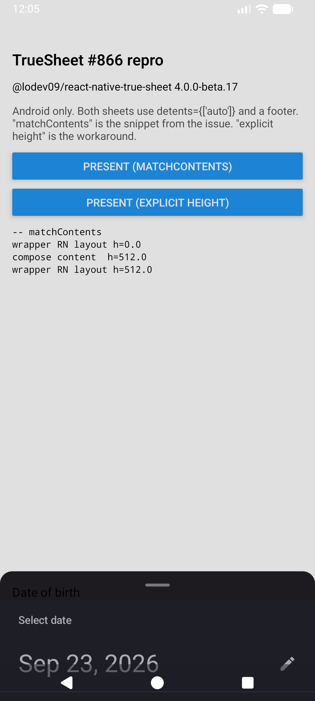
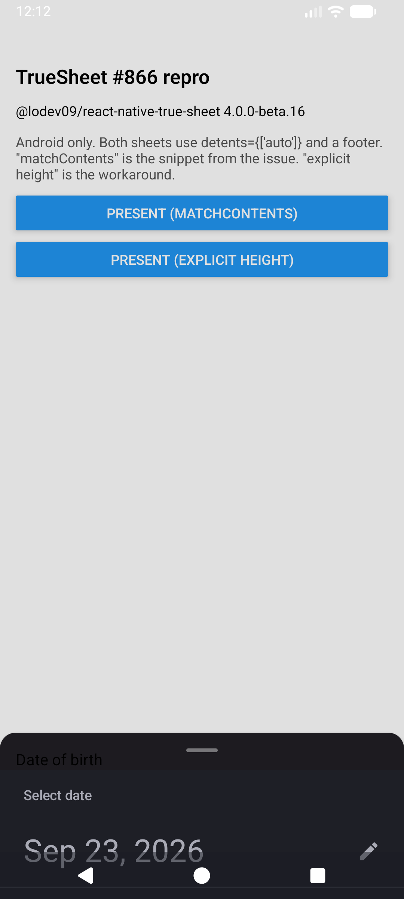

# TrueSheet #866 repro

Minimal reproduction for [lodev09/react-native-true-sheet#866](https://github.com/lodev09/react-native-true-sheet/issues/866).

On Android, a sheet with `detents={['auto']}` and a footer does not grow to fit an `@expo/ui` `<Host matchContents>` child. The sheet stays small, the footer is not visible, and the date picker is drawn below the screen.

## Environment

| | |
|---|---|
| `@lodev09/react-native-true-sheet` | `4.0.0-beta.17` (also happens on `4.0.0-beta.16`) |
| `@expo/ui` | `57.0.6` |
| expo | `~57.0.24` |
| react-native | `0.86.3` (New Architecture) |
| react | `19.2.3` |
| Device | Android emulator, API 37 (`sdk_gphone16k_arm64`) |

## Run

```sh
npm install
npx expo run:android
```

Then tap:

- **Present (matchContents)**: the snippet from the issue. The sheet opens at about 17% of the screen. Only the "Date of birth" label and the top of the picker are visible. The footer is not visible.
- **Present (explicit height)**: the workaround from the issue (`onLayoutContent` drives an explicit height). The sheet opens at full height with the calendar and the footer.

To try another version, change `@lodev09/react-native-true-sheet` in `package.json`, then run `npm install` and `npx expo run:android` again. A native rebuild is needed.

## Result

| beta.17, matchContents | beta.16, matchContents | beta.17, explicit height |
|---|---|---|
|  |  |  |
